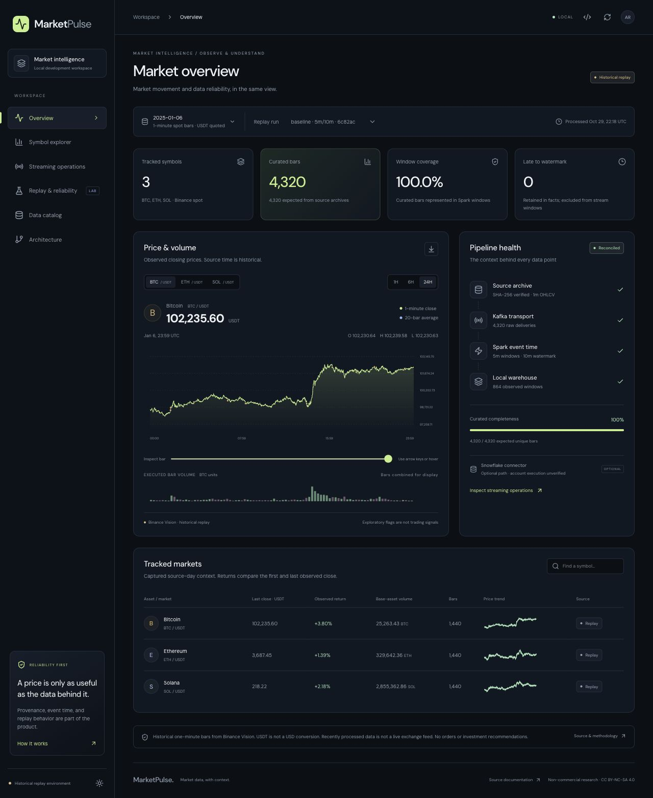

# MarketPulse

A local market-data replay lab. It follows historical price bars through Kafka, Spark, and PostgreSQL, then shows the results in a Next.js dashboard.

The question behind it: what happens to a data pipeline when messages arrive late, repeat, or fail halfway through processing?

**Python · Kafka · Spark Structured Streaming · PostgreSQL · FastAPI · Next.js · TypeScript**



[Case study](portfolio/case-study.md) · [Architecture](docs/architecture.md) · [Verification](docs/verification.md)

## Run the demo

Install Docker with Compose and `make`.

```sh
git clone https://github.com/anushaxrama/marketpulse.git
cd marketpulse
make demo
```

Open the [dashboard on port 8031](http://127.0.0.1:8031) or [API docs on port 8030](http://127.0.0.1:8030/docs). The first build downloads dependencies and source archives; no API key or cloud account is needed.

The default replay contains 4,320 one-minute bars for BTCUSDT, ETHUSDT, and SOLUSDT from Binance Vision on January 6, 2025. Dashboard prices are historical and quoted in USDT.

## Try the failure cases

```sh
make replay SCENARIO=duplicate
make replay SCENARIO=late
make replay SCENARIO=restart
```

Compare the expected and observed counts, audit decisions, and window results. Late bars stay in the fact table even when a watermark excludes them from closed windows.

The pipeline records facts, audit decisions, and an outbox in one PostgreSQL transaction. Downstream publication can repeat; database identities and windowed deduplication handle retries. It does not claim end-to-end exactly-once delivery.

## Code to start with

- `marketpulse/` — contracts, CLI, and replay orchestration.
- `services/` — ingestion, Spark queries, API, and warehouse loader.
- `apps/dashboard/` — Next.js interface.
- `warehouse/` — migrations and analytical queries.
- `tests/` and `docs/` — checks, failure cases, and execution records.

Run `make test`, `make verify`, and `make benchmark` for the available checks. Some checks require the running stack; see the [runbook](docs/runbook.md).

## Recorded results and scope

The [verification record](docs/verification.md) includes 33 Python tests with one Snowflake test skipped, two chart tests, eight browser journeys, and eight streaming experiments. The recorded baseline processed all 4,320 bars in 29.68 seconds, including JVM startup. This is a small local replay, not a production-capacity benchmark.

The lab runs one worker and caps datasets at 10,000 events. It does not provide live trading, forecasting, high availability, or a hosted service. Snowflake export is implemented but unverified against an account. More detail: [benchmarks](docs/benchmarks.md), [streaming semantics](docs/streaming-semantics.md),.

Use `make stop` to stop services while keeping data. `docker compose down -v` removes the local volumes and checkpoints.

Code: [MIT](LICENSE). Source data has separate [terms and attribution](docs/data-license.md).
