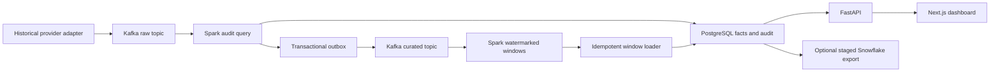

# MarketPulse

MarketPulse processes historical market bars through Kafka and Spark Structured Streaming, loads PostgreSQL, and serves a dashboard for inspecting both price movement and feed reliability. Its replay lab changes delivery conditions so duplicate, late, reordered, and invalid messages can be traced through the same pipeline.

The default source is one day of official Binance Vision spot archives for BTCUSDT, ETHUSDT, and SOLUSDT. These are one-minute OHLCV bars, not ticks or quote snapshots. Every view labels the data as historical replay. Prices are quoted in USDT, not converted to USD.

## What works

- A Python provider adapter downloads and verifies source ZIP files against their published SHA-256 checksums.
- Kafka carries versioned raw and curated envelopes with fixed per-symbol partition assignments.
- The first Spark query validates deliveries and commits bar facts, audit decisions, and an outbox in one PostgreSQL transaction.
- The second Spark query creates event-time windows with a configurable watermark and bounded duplicate suppression inside each window.
- Transactional batch records make a repeated warehouse write a no-op. Checkpoint recovery is exercised after a committed sink batch is deliberately interrupted.
- SQL derives adjacent log returns, moving averages, unannualized volatility, exploratory return flags, and data-quality results.
- A Next.js dashboard includes six views, a light-theme option, keyboard chart inspection, CSV exports, and a gated local replay form.
- An optional Snowflake exporter stages JSON files, runs COPY, checks counts and conflicts, and merges accepted bar identities into an existing account.

Snowflake account execution and licensed live subscriptions are not verified. The application runs locally without either one. There is no order execution, forecasting service, or investment recommendation feature.

## Run the local demo

Requirements: Docker with Compose and `make`. The first build downloads Java, Spark, the matching Kafka connector, and frontend packages, so allow several minutes. No market-data key or cloud account is required.

```sh
cd marketpulse
make demo
```

`make demo` builds and starts the local services, explicitly enables the bounded local replay form, and queues a baseline replay. The worker prepares the source dataset if it is not already cached. The command waits for an actual completed or failed run; it does not report success before the pipeline finishes.

Open the dashboard at [http://127.0.0.1:8031](http://127.0.0.1:8031). FastAPI documentation is at [http://127.0.0.1:8030/docs](http://127.0.0.1:8030/docs).

Without `make`, run:

```sh
MP_LAB_ENABLED=true docker compose up -d --build
docker compose exec -T api marketpulse demo
```

The default source day is January 6, 2025: three archives and 4,320 bars. Downloaded data and checkpoints stay in local volumes and are not included in Git. The source has non-commercial attribution and share-alike terms; see [data licensing](docs/data-license.md).

### A short walkthrough

With the stack running:

1. Open Overview and inspect the historical-mode badge, source date, prices, volume, and completeness.
2. Select another symbol or a one-hour chart. Inspect a bar with the keyboard slider and export the displayed rows.
3. Open Streaming operations to inspect actual Spark batch progress, watermarks, duplicate counts, and measured processing delay.
4. Open Replay & reliability, choose a scenario, and review its bounded configuration before launching it.
5. Compare completed runs using expected counts, observed counts, and the retained event-ID fingerprint.
6. Open Data catalog or Architecture to inspect provenance and the failure boundaries.

## Architecture



The local stack uses Python 3.12, Kafka 3.9.1, Spark 4.0.4 with its Scala 2.13 Kafka connector, Java 17, PostgreSQL 16, FastAPI, Next.js, React, TypeScript, and Tailwind. Python and frontend dependency locks are committed. Source responsibilities and design decisions are described in [architecture](docs/architecture.md) and [ADRs](docs/adrs.md).

## Replay and failure behavior

```sh
make replay SCENARIO=duplicate
make replay SCENARIO=late
make replay SCENARIO=restart
make replay SCENARIO=warehouse_retry
make replay SCENARIO=baseline WINDOW=15 WATERMARK=30
```

| Scenario | Delivery change and expected behavior |
| --- | --- |
| `baseline` | Publish historical bars in time order; all unique bars should reconcile with the windows. |
| `duplicate` | Add a copy of every 100th event; audit the extra deliveries without adding unique facts. |
| `late` | Hold each symbol's first bar until the end; retain the facts while Spark drops those old bars from closed windows. |
| `reorder` | Shuffle three-minute blocks with seed 42; default ten-minute tolerance should preserve window counts. |
| `outage` | Pause the local producer for one second before delivery. This is an injected producer pause, not an observed provider outage. |
| `restart` | Interrupt acknowledgement after a window sink commit, then restart the query from the same checkpoint. |
| `warehouse_retry` | Exercise the same commit-boundary failure to verify the sink batch ledger prevents double writes. |
| `poison` | Append an invalid schema/price envelope labeled synthetic test; quarantine it and publish it through the dead-letter outbox. |

The `restart` and `warehouse_retry` names use the same injected boundary. They do not represent two different infrastructure-failure mechanisms. HTTP timeouts, rate limits, corrupt files, and interrupted publication are tested separately with isolated fixtures and test doubles.

Each run has a unique instance ID and its own checkpoints. A deterministic replay ID identifies the source/configuration/scenario/seed combination. Repeating a configuration gives a comparable replay identity without reusing another experiment's state. Window choices are 1, 5, or 15 minutes; watermark tolerances are 2, 10, or 30 minutes.

At most three runs may be queued or running, only one worker executes at a time, and the registered dataset is capped at 10,000 source events. Lab launch is disabled unless `MP_LAB_ENABLED=true`. The frontend requires confirmation and rejects cross-origin launch requests outside the configured loopback allowlist.

## Delivery guarantees

Kafka, Spark checkpoints, PostgreSQL transactions, and Snowflake transactions do not share one atomic commit. This project does not claim end-to-end exactly-once delivery.

The PostgreSQL sink uses `(run_id, event_id)` for bar identity and `(run_id, stage, batch_id)` for Spark sink retries. Raw audit identity is topic, partition, and offset. Conflicting content for an existing event is quarantined rather than silently overwriting its first accepted value.

Outbox publication is at least once. A crash after Kafka acknowledges a message but before `sent_at` is committed can resend it. The stream window keeps a set of complete event identities and values, so an identical curated redelivery cannot add volume. That state is bounded by the window and watermark.

The first raw offset is retained across an interrupted producer attempt. A retry can add duplicate deliveries, and the run's input count is measured from the broker's offsets rather than assumed from the source list length.

Late bars remain in the audited fact table even when the window query excludes them. The recorded reconciliation is:

```text
Unique accepted bars = bars represented in stream windows + measured watermark drops
Raw deliveries = accepted + duplicate + invalid + conflicting deliveries
```

Update-mode windows near the end of a bounded replay can remain provisional. There is no fabricated future event to force the last watermark forward. Kafka lag is measured at completion, not presented as perpetual live-feed health.

## Warehouse and market definitions

| Relation | Purpose |
| --- | --- |
| `ops.datasets`, `ops.runs` | Source manifests, replay configuration, outcomes, and measured results |
| `raw.deliveries` | Raw delivery identity, validation decision, and rejection details |
| `marts.fact_bars` | Accepted one-minute bars with decimal OHLCV values and source lineage |
| `ops.outbox` | Pending or acknowledged curated/dead-letter publication |
| `ops.batches`, `ops.progress` | Committed sink batches and actual Spark progress/offsets |
| `marts.stream_windows` | Spark-produced OHLCV windows |
| `marts.dim_symbols`, `dim_providers`, `dim_calendar` | Registered markets, observed providers, and UTC session context |
| `marts.bar_features` | Returns, moving averages, volatility, gap flags, and prior-baseline anomaly scores |
| `marts.fact_data_quality_events` | Duplicate, invalid, and conflicting deliveries |

Prices and volumes are stored as PostgreSQL `numeric(28,12)` and Spark decimals. Financial API values are serialized as strings. The UI converts them to numbers for plotting and display, not for the stored analytical calculations.

Log returns are calculated only between adjacent observed one-minute bars. Missing intervals are not filled. Moving averages and rolling volatility require a contiguous 20-bar window. Realized volatility is the square root of summed squared available log returns; rolling standard deviation is reported separately. Neither measure is annualized.

The anomaly score compares the current log return with 20 preceding available log returns and uses a denominator floor. A threshold of 3.5 marks an exploratory observation, not a trading signal. Sparse history, gaps, volatility regimes, and repeated comparisons limit interpretation.

These crypto spot markets trade continuously. UTC is the session basis; no equity holiday calendar is invented. The dataset is unadjusted, contains three selected surviving symbols, and does not establish whole-market performance or handle corporate actions and token redenominations. See [the event contract](docs/data-contracts.md) and [streaming semantics](docs/streaming-semantics.md).

## API and configuration

| Resource | Contents |
| --- | --- |
| `/health` | Database connectivity |
| `/api/overview` | Selected replay, source dataset, symbol summaries, and mode |
| `/api/series` | Filtered one-minute bars and features |
| `/api/windows` | Actual Spark window results |
| `/api/operations` | Audit totals, quality records, batches, progress, and outbox state |
| `/api/runs` | Paginated replay history, including failed attempts |
| `/api/catalog` | Sources, fields, sessions, schemas, and limits |
| `POST /api/lab/replays` | Bounded local job submission when explicitly enabled |
| `/metrics` | Prometheus-compatible replay telemetry |

Query parameters validate UUIDs, symbols, ranges, and pagination. SQL is parameterized, database statements have a timeout, and the API has a per-client request budget. The dashboard uses a same-origin server-side proxy. Database and Snowflake credentials never enter frontend code.

| Variable | Local default or use |
| --- | --- |
| `MP_DATABASE_URL` | Native PostgreSQL connection on `127.0.0.1:5546` |
| `MP_KAFKA_BROKERS` | `localhost:19094` natively; `kafka:9092` inside Compose |
| `MP_DATA_DIR` | Native `data/` directory or Compose `/data` volume |
| `MP_LAB_ENABLED` | `false`; `make demo` explicitly enables local launch |
| `MP_DASHBOARD_ORIGINS` | Exact allowed origins for the dashboard's launch proxy |
| `MP_TEST_DATABASE_URL` | Separate disposable `marketpulse_test` database |

The checked-in credentials are local demo values. Services bind their host ports to loopback. Do not expose this development stack as a public financial service.

## Tests and evidence

Native tests require Python 3.12 with uv. Frontend development uses Node 24 and pnpm 11.25.

```sh
make test
```

Database-dependent tests skip without an explicit disposable database. Create it once if it does not already exist, then run:

```sh
docker compose exec postgres createdb -U marketpulse marketpulse_test
make test-integration
make test-browser
```

Browser tests require the populated application. `make test-browser` uses installed Chrome; alternatively install Chromium through Playwright and run `pnpm --dir apps/dashboard test:e2e` without the Chrome override.

```sh
make verify
make benchmark
```

`verify` runs the real replay experiments and records aggregate evidence. `benchmark` queues another actual baseline and prints measured runtime, throughput, and curation-delay percentiles. JVM startup and local database work are included. These are small local replay measurements, not sustained production throughput or evidence of an optimization.

See [verification](docs/verification.md), [measured benchmarks](docs/benchmarks.md), and [the status matrix](portfolio/project-status.json). Python tests use labeled synthetic fixtures in a separate database. Real historical sources and synthetic poison envelopes remain distinguishable.

## Optional Snowflake export

The local application never provisions or automatically connects to Snowflake. To test the exporter, supply an existing account, user, private-key file, database, schema, and warehouse through the variables in `.env.example`:

```sh
uv sync --frozen --extra snowflake
uv run marketpulse snowflake --run-id YOUR_COMPLETED_RUN_UUID --execute
```

The explicit `--execute` flag permits SQL that can consume credits on the configured warehouse. The exporter creates its own stage and tables inside the existing schema, verifies staged counts, rejects conflicting identities, then runs MERGE and a batch-ledger insert in one transaction. Repeating the same export returns `already_loaded`.

Snowflake uniqueness constraints are informational. Exporters must be serialized; concurrent account-level exports have not been tested. The local PostgreSQL schema is not a claim of identical Snowflake execution behavior. See [warehouse strategy](docs/warehouse-strategy.md) for the SQL path, permissions, retry boundary, staging cleanup, and unverified integration status.

## Operations and teardown

```sh
make logs
make stop
```

`stop` preserves local volumes. `docker compose down` removes the project containers and network but keeps the data volumes. Only use `docker compose down -v` when deliberately discarding this project's database, archives, broker logs, and checkpoints.

The single Kafka broker has a replication factor of one. Spark runs as `local[2]` in one container. High availability, long-running load, distributed recovery, hosted authentication, external alerts, licensed live feeds, and cloud deployment are outside the verified local scope.

## Repository map

```text
marketpulse/                  Shared contracts, database, CLI, replay orchestration
services/ingestor/            Provider and Kafka publication adapters
services/stream_processor/    Actual Spark Structured Streaming queries
services/warehouse_loader/    PostgreSQL sink and optional Snowflake exporter
services/api/                 FastAPI application
apps/dashboard/               Next.js, React, TypeScript, and Tailwind UI
warehouse/                    Numbered migrations, models, and data checks
infra/                        Isolated runtime images and connector resolution
scripts/                      Reproducible real-stream verification
tests/                        Contracts, HTTP, SQL, API, and recovery tests
docs/                         Decisions, recovery notes, measured evidence
portfolio/                    Case study, project card, resume and interview notes
```

The [runbook](docs/runbook.md), [security notes](docs/security.md), [deployment options](docs/deployment.md), and [case study](portfolio/case-study.md) provide the remaining detail. This repository is independent of SignalFlow and AtlasIQ and does not modify their applications or a personal portfolio website.
