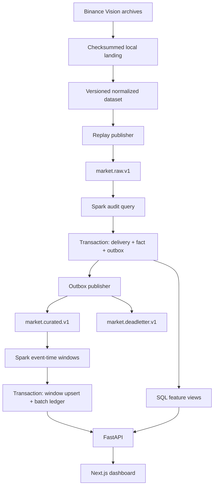

# Architecture

MarketPulse uses two real Kafka-backed Spark Structured Streaming queries. The default run is a bounded replay of historical one-minute spot bars, rather than a live exchange subscription. PostgreSQL is the local analytical and operational store. Snowflake is a separate optional export boundary.

## Responsibilities

| Component | Responsibility |
| --- | --- |
| Provider adapter | Fetch archives, check published hashes, validate the 12-column source schema, normalize decimal values and UTC timestamps |
| Replay orchestrator | Create an isolated run, retain starting offsets, change delivery order or multiplicity, and record actual outcomes |
| Kafka raw topic | Preserve replay envelopes by symbol; expose partition/offset provenance |
| Spark audit query | Validate envelopes in each micro-batch and call the transactional event loader |
| PostgreSQL audit loader | Record delivery outcomes, accept unique bar identities, quarantine conflicts, and create outbox rows atomically |
| Outbox publisher | Send accepted events and rejection records to curated/dead-letter Kafka topics with acknowledgement |
| Spark window query | Apply event-time watermarking and per-window identity-set aggregation |
| Window loader | Upsert complete observed window values and commit the batch ledger in the same transaction |
| SQL feature layer | Calculate adjacent returns, contiguous moving features, and prior-baseline anomaly scores |
| FastAPI | Serve bounded parameterized queries and a gated local replay queue |
| Next.js | Present source mode, charts, operations, experiment comparisons, lineage, and definitions |
| Optional Snowflake exporter | PUT source-derived JSON to an internal stage, COPY, validate, MERGE, and record the batch |

## Data flow

The raw query uses Spark's Kafka source and durable checkpoints even though validation and the PostgreSQL sink run in `foreachBatch`. The curated query uses Spark's own watermark and grouped window state. It is not a Python loop presented as Spark processing.

## Isolation

Each replay instance owns its checkpoint directory. Its Kafka start offsets are captured before publication. Curated offsets are also captured so a new run need not scan the entire previous experiment history. A PostgreSQL advisory lock permits one worker per database. A bounded queue separates browser requests from Spark execution.

The worker runs `local[2]` inside a Java 17/Python 3.12 container. The local broker has three partitions and a replication factor of one. Neither topology represents a distributed production cluster.

SignalFlow and AtlasIQ have separate code and state. MarketPulse uses its own Compose project, ports, network, database, broker, volumes, and repository.

## Serving

Bar facts and window values are read directly from PostgreSQL. Model views are versioned through numbered SQL migrations. No fabricated market records are inserted into the application warehouse. Synthetic fixtures use a separate database; the poison experiment's invalid envelope is labeled synthetic and never enters financial facts.

The UI distinguishes historical event timestamps, replay processing timestamps, measured curation delay, and the watermark. A recent replay does not make January 2025 data current.
