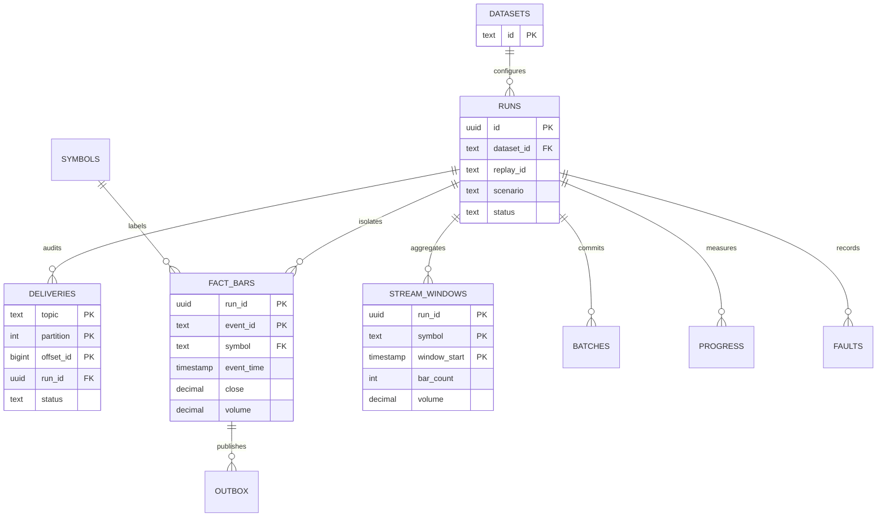

# Local model relationships

The diagram shows logical outbox/run associations; not every operational relationship is a declared foreign key. Fact and active-run relationships are enforced in PostgreSQL. Snowflake does not enforce the same uniqueness constraints.
